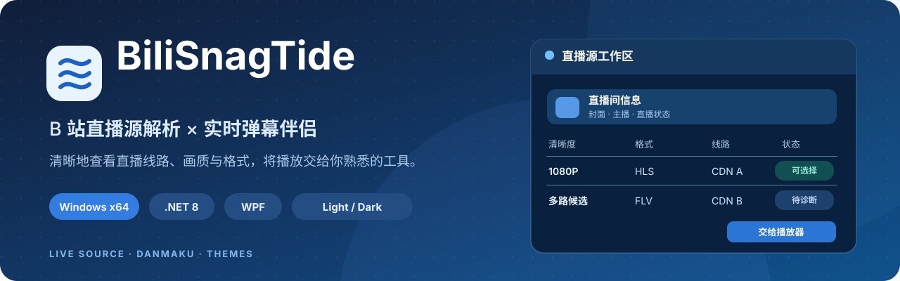
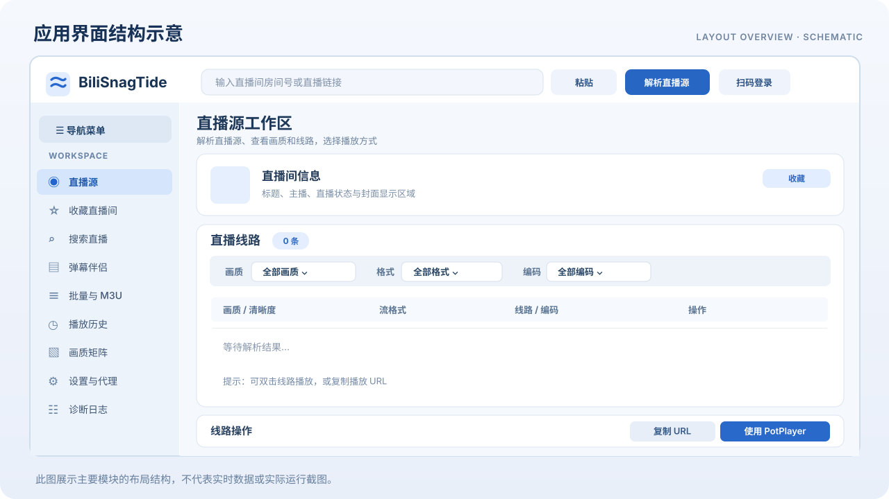
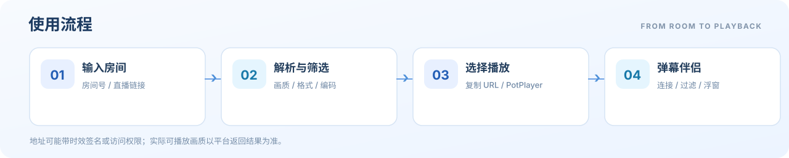
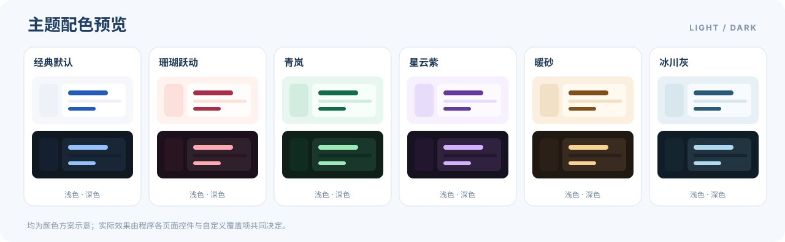

<p align="center">
  
</p>

<h1 align="center">BiliSnagTide</h1>

<p align="center">
  <strong>Bilibili 直播源解析 · 画质与线路管理 · PotPlayer 播放 · 实时弹幕伴侣</strong><br/>
  一款为 Windows 桌面打造的 B 站直播辅助工具，使用 C# / WPF / .NET 8 构建。
</p>

<p align="center">
  <a href="https://github.com/lvnl123/BiliSnagTide/releases"></a>
  <a href="https://github.com/lvnl123/BiliSnagTide/actions/workflows/windows-release.yml"></a>
  
  
  
</p>

<p align="center">
  <a href="#-项目简介">项目简介</a> ·
  <a href="#-界面预览">界面预览</a> ·
  <a href="#-功能一览">功能一览</a> ·
  <a href="#-下载与安装">下载与安装</a> ·
  <a href="#-使用流程">使用流程</a> ·
  <a href="#-主题与个性化">主题配色</a> ·
  <a href="#-源码构建">源码构建</a>
</p>

---

## ✨ 项目简介

**BiliSnagTide** 将直播间解析、线路管理、外部播放器与弹幕观看放进同一个 Windows 桌面工作区。

不用在多个网页之间反复复制地址：输入直播间号或 `live.bilibili.com` 链接，获取当前可返回的播放线路，按画质、格式和编码筛选，然后复制 URL、导出 M3U，或交给 **PotPlayer**。需要时，还可以单独连接弹幕、打开弹幕浮窗，查看连接状态与消息流。

> [!NOTE]
> 这是**第三方非官方项目**，与哔哩哔哩（Bilibili）没有隶属关系。播放源、清晰度、登录权限和接口可用性均受平台实际返回结果影响。本工具不提供直播内容录制功能。

## 🖥️ 界面预览

<p align="center">
  
</p>

<p align="center"><sub>主界面<strong>结构示意图</strong>，用于说明布局及功能分区；不是软件实际运行截图，也不代表实时线路数据。</sub></p>

设计以直播源工作区为中心，左侧是可折叠导航，右侧按「**直播间概览 → 线路列表 → 播放操作**」组织内容；避免复杂操作挤占主要表格空间。设置页提供浅色、深色和自定义配色工作台。

## 🚀 功能一览

| 模块 | 提供的能力 |
|:--|:--|
| 📡 **直播源解析** | 输入房间号或直播间链接；获取平台当前可返回的 FLV / HLS 候选播放源及多条线路 |
| 🎞️ **画质与编码** | 按清晰度、流格式和编码筛选；支持多画质扫描与画质诊断，具体质量以接口及账号权限为准 |
| ▶️ **播放器联动** | 复制播放 URL、选择线路、打开 PotPlayer；支持本机代理链接与 M3U 播放列表 |
| 💬 **弹幕伴侣** | 单独连接直播弹幕，显示消息、连接状态、心跳及重连信息，并可打开弹幕浮窗 |
| 🔎 **弹幕筛选** | 关键词包含 / 排除、忽略特定昵称、礼物与消息显示控制 |
| ⭐ **收藏与监控** | 收藏常用直播间、查看开播状态、配置监控间隔与本机通知 |
| 🕘 **检索与历史** | 搜索直播间、保存播放历史、批量管理房间与导出 M3U |
| 🛠️ **诊断与工具** | 线路连接诊断、画质信息、运行日志、设置和本地代理管理 |
| 🎨 **个性化外观** | 六套主题预设、独立浅色/深色配色、颜色角色自定义、主题 JSON 导入导出、减少动画 |
| 🔄 **软件更新** | 自动与手动检查 GitHub 正式 Releases、更新日志、软件内下载进度、SHA-256 校验、前往 GitHub 下载 |

**额外说明：** 帧率、分辨率等媒体属性检测可能需要你自行配置 `ffprobe`；PotPlayer 属于外部播放器，程序不附带它们。

## 📥 下载与安装

**官方发布入口：** **[GitHub Releases — 查看可下载版本](https://github.com/lvnl123/BiliSnagTide/releases)**

发布构建支持下面两种 Windows x64 交付方式。**请以 Releases 页面上实际显示的附件为准**；历史版本的绿色版可能是 ZIP，较新的构建配置支持单文件 EXE。

| 版本 | 适合谁 | 运行方式 | 用户数据 |
|:--|:--|:--|:--|
| **绿色便携版（Portable）** | 想直接运行、随身携带、不安装程序 | 下载 `*Portable.exe` 后双击运行；旧版 ZIP 需要先解压 | 绿色单文件版：EXE 同目录的 `Data/` |
| **标准安装版（Setup）** | 希望有开始菜单入口和卸载流程 | 运行 `*Setup.exe`，按安装向导操作 | `%LOCALAPPDATA%\BiliSnagTide` |

两种构建均使用 **.NET 8 自包含发布**，普通用户**不需要安装 .NET SDK**；支持 Windows x64。v4.6.0 起可在设置页检查 GitHub 正式版本并在软件内下载验证。PotPlayer、ffprobe 等外部工具如需使用，仍需自行安装。

<details>
<summary><strong>绿色便携版存放在哪里更合适？</strong></summary>

建议单独放在有写入权限的文件夹，例如 `D:\Apps\BiliSnagTide\`。程序会在 EXE 旁创建 `Data/` 保存设置、收藏与日志；不要把它直接放进需要管理员权限写入的系统目录。

v4.6.0 单文件编译配置不需要 `portable.flag`。若使用旧版 v4.5.3 的绿色 ZIP，请保留包内原有文件结构和 `portable.flag`。
</details>

<details>
<summary><strong>下载时 Windows 显示「未知发布者」怎么办？</strong></summary>

目前发行文件没有代码签名，因此可能出现 SmartScreen 安全提示。应当优先核对下载来源是否为本仓库的 Releases 页面；对来源不明、经第三方修改的程序保持谨慎。
</details>

## 🧭 使用流程

<p align="center">
  
</p>

1. **输入房间**：在顶部填写 B 站直播间房间号或直播间链接。
2. **解析线路**：点击「解析直播源」，查看返回的画质、格式、编码和线路；必要时先扫码登录。
3. **播放或导出**：选择合适的地址，复制 URL、导出 M3U 或交给 PotPlayer。若使用本地代理，运行期间需保持 BiliSnagTide 开启。
4. **查看弹幕**：切换到「弹幕伴侣」，连接弹幕、设置筛选规则，按需打开独立浮窗。

> [!TIP]
> 播放地址往往含有**短时效签名或鉴权信息**，过期后需要重新解析。不要将完整带令牌的播放地址发布到公开 Issue、截图或日志中。

## 🎨 主题与个性化

<p align="center">
  
</p>

<p align="center"><sub>以上为六套配色的示意图，不是程序实际截图。</sub></p>

配色工作台提供：

- **六套预设**：经典默认、珊瑚跃动、青岚、星云紫、暖砂、冰川灰。
- **分别设置浅色与深色**：两种模式的颜色独立保存；经典默认方案优先使用浅色启动。
- **细粒度自定义**：主背景、侧栏、顶部、按钮、表格、输入框、提示条、状态栏、弹幕浮窗等颜色角色可以逐项调整。
- **实时预览与管理**：预览、恢复、导入/导出 JSON、自定义色彩对比度提醒。

菜单栏默认展开；点击三条杠 `☰` 收起后显示 `>`，再次点击恢复展开。页面过渡和侧栏动画可以通过「减少动画」选项降低。

## 🧩 源码构建

项目源码位于 `Source/`，适合在 Windows 10/11、Visual Studio（**.NET 桌面开发**工作负载）或 .NET 8 SDK 的命令行环境下开发。

### 常规开发构建

```powershell
dotnet restore .\Source\BiliSnagTide.csproj
dotnet build .\Source\BiliSnagTide.csproj -c Release
```

### 发布绿色单文件 EXE（Windows x64）

```powershell
dotnet publish .\Source\BiliSnagTide.csproj `
  -c Release -r win-x64 --self-contained true `
  -p:PortableBuild=true -p:PublishSingleFile=true `
  -p:IncludeNativeLibrariesForSelfExtract=true `
  -o .\out\portable
```

`PortableBuild=true` 在**编译时**启用便携数据目录模式，编译得到的 `BiliSnagTide.exe` 可直接运行。标准安装版则使用 `PortableBuild=false`，再由 Inno Setup 打包。

### 仓库结构

```text
BiliSnagTide/
├── Source/               # C# / WPF 主程序、XAML、图标与项目文件
├── Themes/               # 示例主题 JSON
├── docs/images/          # README 横幅及功能示意图（SVG）
├── packaging/            # Inno Setup 安装器与发布说明
├── .github/workflows/    # Windows CI / Releases 构建流程
├── .gitignore
└── README.md
```

构建使用正常的 `bin/`、`obj/` 和指定的输出目录，**不会创建旧版 `D:\BiliLiveBuildCache`**。仓库不包含 SDK 下载器、旧的一键缓存构建脚本或编译产物。发布的单文件 EXE 在运行时仍可能按 .NET 机制解包部分原生组件到系统临时目录。

## ❓ 常见问题

<details>
<summary><strong>为什么只看到部分画质，或没有线路？</strong></summary>

直播间状态、账号登录权限、平台接口返回、线路可用性、格式及编码支持均会影响结果。可以检查直播间是否正在直播、尝试扫码登录、重新解析，或使用「画质诊断」查看具体情况。软件不会承诺所有直播间都有 2K、1080P 或某种固定格式。
</details>

<details>
<summary><strong>为什么 PotPlayer 不能直接播放？</strong></summary>

确认 PotPlayer 已安装、播放器路径正确，并尝试其他可用格式或 CDN；某些地址对请求头或登录状态有要求，且签名 URL 会过期。使用本地代理时，BiliSnagTide 必须保持运行。
</details>

<details>
<summary><strong>弹幕浮窗是否需要同时打开播放器？</strong></summary>

弹幕连接与视频播放是相互独立的：可以单独连接弹幕并显示浮窗，也可以配合外部播放器使用。网络状态和平台协议变化可能影响弹幕连接。
</details>

<details>
<summary><strong>程序会上传 Cookie、账号或收藏数据吗？</strong></summary>

项目需要连接 B 站直播相关接口以取得用户请求的数据，登录后可能使用本机保存的登录状态。收藏、设置与诊断日志由程序保存在本地数据目录。请勿在 Issues 中公开 Cookie、Token、签名 URL 或其他个人信息；具体行为可通过源码审查。
</details>

## 🛡️ 安全与使用说明

- 本项目**不是 Bilibili 官方软件**，不保证平台接口永久兼容，也不承诺绕过账号权限或清晰度限制。
- 本地播放代理使用回环地址 `127.0.0.1`；它不是向公网提供的流媒体服务器。
- 登录凭证、代理 Token 和带签名的播放 URL 不应提交到公开仓库或问题反馈。
- 本项目用于管理用户可以合法访问的直播内容；请遵守平台规则及内容权益要求。
- 本项目不含直播录制功能；外部工具及服务的授权规则以各自官方说明为准。

## 🤝 反馈与维护

遇到 Bug 或希望改进功能，可前往 **[Issues](https://github.com/lvnl123/BiliSnagTide/issues)** 提交反馈。建议附上 Windows 版本、应用版本、复现步骤和**已移除敏感信息**的错误日志。

- **源码：** [GitHub 仓库](https://github.com/lvnl123/BiliSnagTide)
- **下载：** [GitHub Releases](https://github.com/lvnl123/BiliSnagTide/releases)
- **自动构建：** [Windows Release Workflow](https://github.com/lvnl123/BiliSnagTide/actions/workflows/windows-release.yml)

---

<p align="center">
  <sub>Built with C# · WPF · .NET 8 · Windows</sub><br/>
  <sub>专注直播源管理与弹幕体验，保留对不同播放工具和个性化界面的选择。</sub>
</p>